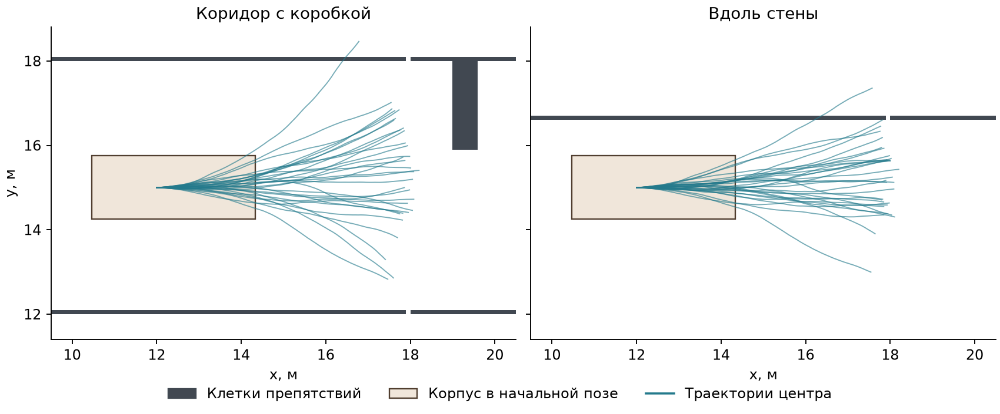

# Fleet MPPI

Сколько складских роботов может обслуживать один сервер навигации? Мы начали с одной из затратных операций в контроллере MPPI из Navigation2. Чтобы выбрать следующую команду, контроллер строит множество возможных траекторий. Критик `CostCritic` проверяет, пройдёт ли корпус робота мимо препятствий. Вдоль стеллажа ему часто приходится проверять контур даже при свободном пути.

**В сцене с одной стеной** штатный критик тратил 15,97 мс процессорного времени на 2000 траекторий. После добавления фильтра тот же расчёт занимал 1,75 мс. В широком коридоре при 32 траекториях разница составила всего 2 мкс. На отдельной выборке из 360 000 траекторий оба режима дали побитово одинаковые стоимости и одинаковые решения о столкновениях. [Таблица и условия опыта](nav2/current/) · [Протокол проверки](nav2/current/equivalence.txt)

## Где возникает выигрыш



На каждой карте показаны 32 возможные траектории центра робота, выгруженные из C++-стенда. Прямоугольник показывает корпус в начальной позе с учётом защитного запаса. В сцене справа робот идёт примерно параллельно стене. Центр может пройти свободно, а передний угол при повороте приблизится к препятствию.

Эта разница видна и в счётчиках стенда. В выборке из 2000 траекторий проверка контура требовалась для 28 % просмотренных поз в коридоре и для 92 % у стены. Именно эту операцию ускоряет фильтр. [Координаты для рисунка](nav2/current/scenes.csv) · [Счётчики штатного алгоритма](nav2/current/upstream.json)

## Что изменено в Nav2

Фильтр включается там, где штатный критик собирается проверить контур. Клетки препятствий упакованы в битовую карту. Для каждого небольшого диапазона углов и смещений робота заранее строится маска, которая целиком покрывает возможные положения его контура. Если под маской свободно, детальный обход контура можно пропустить. Когда маска задевает препятствие, стоимость позы вычисляет штатная функция Nav2.

Изменение оформлено отдельным патчем для [Nav2 `bdb75f4`](https://github.com/ros-navigation/navigation2/tree/bdb75f435ecb79d92266060801ba6d95e23447db). В опытной сборке фильтр включается параметром `CostCritic.use_footprint_bitmask`. По умолчанию он выключен. [Патч контроллера](nav2/current/footprint.patch) · [Сборка и запуск](nav2/current/#сборка)

## Время одного вызова CostCritic


Каждая точка — медиана пяти повторов на одном потоке Apple M4 в Docker. Вертикальная шкала логарифмическая. Штатный Nav2 измерялся отдельно. В опытной сборке прогоны с фильтром и без него чередовались в случайном порядке. Так можно сравнить два режима одного бинарного файла и отдельно проверить выигрыш относительно штатного Nav2.

Из корня репозитория можно пересчитать таблицу из исходных повторов. Скрипт использует только стандартную библиотеку Python.

```bash
uv run --no-project python tools/report_costcritic.py
```

## Как перейти от одного критика к флоту

Стенд измеряет один вызов критика на двух постоянных картах. Чтобы ответить на исходный вопрос о числе роботов, следующий опыт должен охватывать полный цикл выдачи команды. На одном сервере нужно постепенно увеличивать число экземпляров контроллера и для каждого робота измерять задержку от получения позы до доставки команды. Критерий вместимости — сколько роботов успевают получать команды с заданной частотой. [Стенд полного цикла из предыдущей серии](nav2/patch/fleet_server_benchmark.cpp)

Для малых выборок остаётся отдельная гипотеза. Если запросов контура мало, подготовка битовой карты может стоить дороже сэкономленных проверок. Это можно проверить на маршруте, который выходит из узкого прохода в свободную зону и возвращается обратно, сравнив постоянное включение фильтра с его включением после первых запросов.

## Другие материалы проекта

- [Опыты с задержкой связи и частотой команд](expW/RESULTS.md) и [бортовой буфер траекторий ROS 2](nav2/trajectory_buffer/).
- [Учебная работа по идентификации привода](studies/drive-identification/). Здесь находятся траектории MuJoCo и данные, использованные в эссе.
- [Архив замеров оптимизатора, проверок эквивалентности и экспериментов с выборкой](nav2/RESULTS.md). Старые таблицы производительности относятся к указанным в архиве сборкам.
- [Литература для статьи](docs/references.md) и [песочница планирования движения](https://github.com/byoverr/motion-planning-practice).
