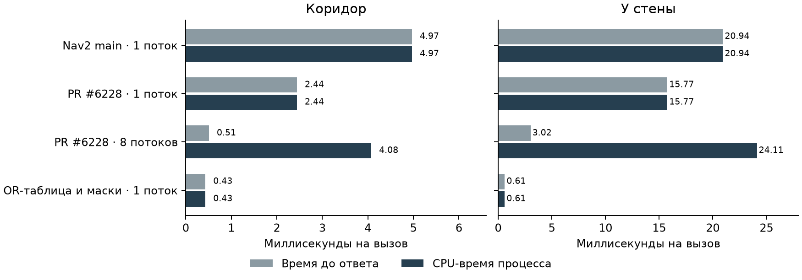

# Fleet MPPI · локальное управление складским флотом на одном сервере

Сколько процессорного времени требуется серверу, чтобы выдать очередную команду каждому роботу? Контроллер MPPI в Navigation2 за один такт оценивает тысячи траекторий. Возле стеллажа для многих положений приходится проверять весь контур корпуса. Если ускорить эту операцию, сохранив решения о столкновениях, один сервер сможет чаще пересчитывать команды или обслуживать больше запросов.

В этом репозитории есть модификация C++-критика `CostCritic`, стенды для сравнения со штатным Nav2 и OpenMP-вариантом, а также исходные журналы. Самостоятельная [песочница motion-planning-practice](https://github.com/byoverr/motion-planning-practice) дала складские сцены для опытов с сетью и движением. Производительность контроллера измерялась в самом Nav2.

## Как работает проверка габарита

1. Препятствия на карте стоимости упаковываются в битовую плоскость. Для полигонального контура робота заранее вычисляются маски по углу поворота и смещению внутри клетки.
2. Для каждой проверяемой позы сначала запрашивается прямоугольник, покрывающий маску. Таблица побитового ИЛИ по строкам карты позволяет быстро установить, что прямоугольник свободен. Если внутри есть подозрительные клетки, проверяется сама маска.
3. Пустое пересечение позволяет пропустить обход контура. При возможном пересечении результат выдаёт штатная точная проверка Nav2. Так учитываются узкие проходы, неизвестные клетки и край карты. [Реализация фильтра](nav2/patch/footprint_bitmask.hpp) · [Сравнение со штатным критиком](nav2/patch/cost_critic_equivalence.cpp).

## Сколько времени экономит фильтр



На графике «Nav2 main» — зафиксированный коммит `2d3d1cc`. Вариант OpenMP из PR #6228 вошёл в основную ветку 9 ноября 2026 года, уже после этих измерений. При сравнении с новой версией Nav2 нужно фиксировать её SHA и число потоков критика. График построен из медиан трёх повторов на Apple M4 под Linux arm64 в Docker. На вызов приходится 2000 траекторий по 100 шагов. У стены переход с одного потока на восемь в OpenMP-варианте сократил ожидание ответа с **15,77 до 3,02 мс**, но увеличил суммарное время CPU с **15,77 до 24,11 мс**. Фильтр с OR-таблицей затратил **0,61 мс CPU** на одном потоке. Это время только одного критика для данного габарита и сцены. Сборки измерялись в разных сеансах. [Штатный Nav2](nav2/results/bench_main.json) · [OpenMP](nav2/results/bench_pr.json) · [Фильтр и его контроль](nav2/results/bench_box.json).

**Совпали ли решения?** В шести конфигурациях стенда проверено 360 000 траекторий, в том числе 154 168 со столкновением. Зафиксировано ноль расхождений стоимости и флага отказа. В набор входили неизвестные участки карты. Полный перечень условий и отрицательные контроли других оптимизаций приведены в отчёте. [Журнал проверки](nav2/results/equivalence_box_unknown.txt) · [Отчёт](nav2/RESULTS.md).

## Что это даёт флоту

В отдельном опыте несколько экземпляров **полного оптимизатора** делили один рабочий поток. В опытной сборке одновременно использованы маски, объединённая генерация траекторий, быстрые суммы и векторизация PathAlign. В таблице число завершённых вызовов в секунду разделено на 20 Гц. Для каждой пары сборки чередовали, приведены медианы трёх повторов.

| Габарит и распределение нагрузки | Штатный Nav2, эквиваленты при 20 Гц | Опытная сборка | Отношение |
|---|---:|---:|---:|
| AMR 0,7 × 0,5 м, коридор | 64,2 | 84,8 | 1,32× |
| Тот же AMR, половина запросов у стены | 42,4 | 79,6 | 1,88× |
| Тот же AMR, все запросы у стены | 31,6 | 77,4 | 2,45× |
| Крупная платформа 3,7 × 1,3 м, все запросы у стены | 3,4 | 57,7 | 17,0× |

Крупный контур делает штатную проверку дороже. Для небольшого AMR в коридоре существенную часть цикла занимают генерация траекторий и другие критики. Эти эквиваленты описывают вычислительную нагрузку. Для оценки рабочего флота дополнительно нужны сроки доставки команд с очередью ROS 2, обновлением карт и сетью. [Все повторы и обе геометрии](nav2/results/vs_main_round4_reps.txt) · [Код стенда](nav2/patch/fleet_server_benchmark.cpp).

## Следующий эксперимент для статьи

**Сначала проверили, есть ли резерв для переключения алгоритма.** В сохранённой серии с шестью сочетаниями габарита и разрешения карты и двумя сценами маски потребовали меньше CPU в 11 из 12 случаев. Если каждому случаю дать одинаковый вес и заранее выбирать лучший режим с нулевой ценой переключения, выигрыш относительно постоянно включённых масок составит всего **0,066 %**. Расчёт использует медианы каждого режима из этой конкретной серии; он характеризует выбор режима на всю сцену. В этих условиях усложнять контроллер таким переключателем мало смысла. [Пересчитать по исходным данным](tools/mask_headroom.py) · [Исходная серия](nav2/results/footprint_sweep.json).

**Гипотеза для следующей модификации — отложенное построение битовой плоскости при малой выборке MPPI.** Сейчас фильтр строит плоскость по карте для вызова критика. При 32 или 125 траекториях в свободном проходе может быть так мало запросов контура, что подготовка не окупается. Вариант для проверки: первые запросы обслуживать штатным способом и строить плоскость только по достижении порога внутри этого же вызова. Значение порога надо подобрать на одних маршрутах и зафиксировать до проверки на других. Результаты замера с большой выборкой не устанавливают порог или величину выигрыша.

Сравнение должно включать актуальный Nav2 с уже принятым OpenMP, постоянно включённые маски и отложенную подготовку при K = 32, 125 и 2000. На одних траекториях и снимках карты сравнивать CPU-время, p99 задержки, стоимости и флаги отказа; в набор включить смену прохода, появление препятствия, неизвестные клетки и край карты. Критерий продолжения — выигрыш против лучшего фиксированного режима на отложенной смешанной нагрузке при совпадении решений. Повтор на x86 дополнит измерения на ARM. Это план эксперимента, реализация и результат ещё предстоят. [Измерение стоимости подготовки](nav2/patch/plane_cost.cpp) · [Журнал опытов с малой выборкой](nav2/RESULTS.md).

## Как воспроизвести и где искать материалы

Из корня репозитория можно перестроить график из сохранённых JSON без ROS и Docker:

```sh
uv run --project mpp --frozen python tools/plot_costcritic.py
```

- **C++ и исходные измерения.** [Измерительные программы и патчи](nav2/patch/) · [результаты](nav2/results/) · [точная ревизия Nav2 и снимок рабочей сборки](nav2/workspace_snapshot/) · [инструкция для двух независимых сборок](studies/drive-identification/nav2/README.md). Для исторического сравнения main/PR/маски сценарий [run_all.sh](nav2/patch/run_all.sh) меняет файлы в рабочем дереве Nav2; он предназначен для отдельной копии внутри контейнера.
- **Связь и бортовой буфер.** [Опыты с задержками, потерями и частотой сервера](expW/RESULTS.md) · [проигрыватель траекторий ROS 2](nav2/trajectory_buffer/).
- **Малая выборка MPPI.** Разделы 17–21 [журнала опытов](nav2/RESULTS.md) и [сопоставление банка шума с ранее опубликованными методами](nav2/NOVELTY_check.md).
- **Учебное эссе о приводе.** [Идентификация, траектории для примера и 64 заезда с раздельной заменой модели](studies/drive-identification/).
- **Предыстория.** [Проверка исходных гипотез](VERIFICATION.md) · [опыты с памятью движения](mpp/docs/research/motion_memory_results.md) · [что удалось восстановить при переносе лаборатории](docs/lab-history.md).

## Работы для сравнения

- Williams, Aldrich и Theodorou описывают MPPI и параллельный расчёт выборки. [Статья о MPPI](https://doi.org/10.2514/1.G001921).
- Thomason, Kingston и Kavraki (VAMP) исследуют SIMD-проверки геометрии при выборочном планировании. Здесь сравнивается стоимость конкретной проверки контура на клеточной карте Nav2. [Статья VAMP](https://doi.org/10.1109/ICRA57147.2024.10611190).
- В Nav2 Smac уже есть предварительный расчёт повёрнутых контуров по угловым интервалам. В исследуемом фильтре по каждому интервалу курса и смещения объединены клетки, которые может прочитать обход контура. Отсюда проверяемый вопрос для статьи — когда дешевле выполнять такой консервативный отсев перед точным запросом. [Код Smac на базовой ревизии](https://github.com/ros-navigation/navigation2/blob/2d3d1cc569b411b2b5f477be620c35796edb75c6/nav2_smac_planner/src/collision_checker.cpp).
- Vlahov и соавторы рассматривают реализацию MPPI на GPU; Trevisan и Alonso-Mora — изменение распределения выборки вспомогательными контроллерами. Это две другие возможности снизить стоимость выбора команды. [MPPI-Generic](https://arxiv.org/abs/2409.07563) · [Biased-MPPI](https://doi.org/10.1109/LRA.2024.3397083).
- Параметры и критерии штатного контроллера описаны в [руководстве Nav2](https://docs.nav2.org/configuration/packages/configuring-mppic.html). [PR #6228](https://github.com/ros-navigation/navigation2/pull/6228) служит внешним сравнением для CostCritic. Принятый [PR автора #6768](https://github.com/ros-navigation/navigation2/pull/6768) исправляет завершение работы генератора шума. Патчи производительности опубликованы в этом репозитории.
