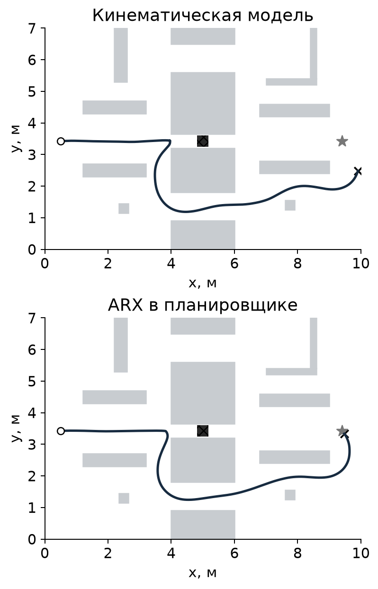
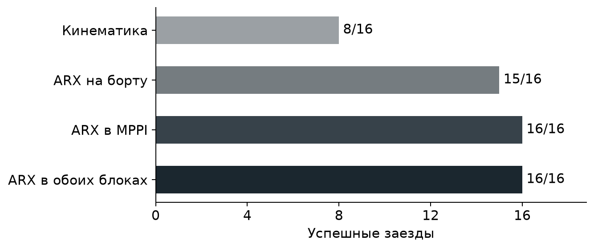
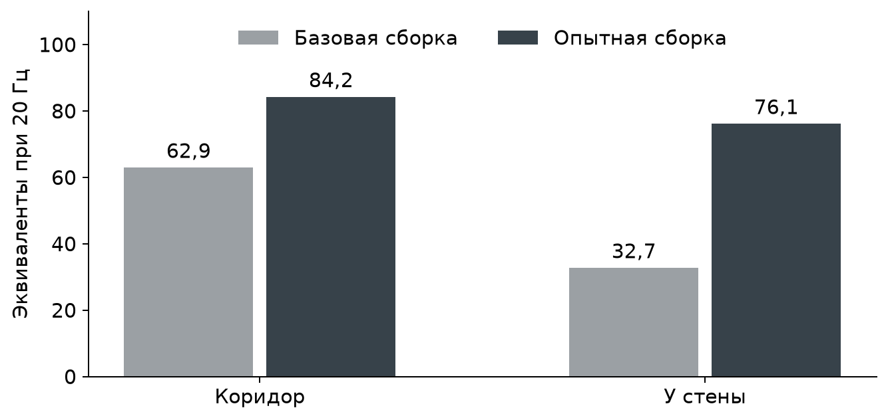

# Модель привода и производительность Nav2 MPPI на складском маршруте

Робот подходит к проходу между стеллажами, когда перед ним падает коробка. Чтобы подобрать манёвр, MPPI многократно прогнозирует движение. Возникают два инженерных вопроса. Насколько точной должна быть модель привода, чтобы выбрать выполнимую траекторию? Сколько таких расчётов в секунду может выполнить общий сервер?

Первый вопрос исследован в **замкнутом контуре MuJoCo**. Второй проверен на **C++-оптимизаторе Navigation2**. В симуляторе модель привода улучшила проезд перекрытого коридора. В стенде Nav2 изменения вычислительного кода увеличили число циклов на поток в 1,34 раза в коридоре и в 2,33 раза у стены.

## Один маршрут, две модели



Коробка обозначена тёмным квадратом, старт — кружком, конец записи — крестом, цель — звездой. Вверху робот с исходной моделью остановился после неудачного проезда, внизу робот с ARX в MPPI доехал по соседнему проходу. В обоих заездах бортовая проверка использовала кинематику. Пример № 303 выбран для иллюстрации отказа исходной модели; частоту успеха показывают все заезды ниже.

## Где помогает идентификация

Стенд использует геометрию TurtleBot3 Burger, предел скорости 0,6 м/с и виртуальный привод с инерцией по каналам скорости и поворота. Два коэффициента усиления и две постоянные времени определяются из записи команд и скоростей. ARX минимизирует ошибку одношагового прогноза, OE подбирает отклик по всей записи команд. На горизонте 1 с в перекрытом проходе 95-й процентиль ошибки положения корпуса составил 5,43 см для кинематики, 1,53 см для ARX и 3,55 см для OE. Эталон — координаты корпуса в MuJoCo. [Параметры и ошибки по горизонтам](results/res_identify_pose.json).

**В первоначальных 48 заездах** сравнивались три модели, две сцены и выборки из 100 и 400 траекторий MPPI. Модель менялась одновременно в планировщике и на борту. В широком проходе все варианты достигли цели. При перекрытии проявилась разница, но такой опыт не позволял разделить вклад двух блоков. [Данные 48 заездов](results/closed_loop.jsonl).

**Новая проверка** меняет модель в каждом блоке независимо. Использованы один перекрытый проход, одинаковые 16 начальных значений (301–316), 100 траекторий на цикл, сервер 10 Гц и связь без потерь и задержек. Первые четыре значения совпадают с первоначальной серией. В каждом из 64 заездов бортовая проверка включена. Успех означает достижение цели без контакта.

| Модель в MPPI | Модель на борту | Успех | Заезды с контактом |
|---|---|---:|---:|
| Кинематика | Кинематика | 8/16 | 4 |
| Кинематика | ARX | 15/16 | 0 |
| ARX | Кинематика | 16/16 | 0 |
| ARX | ARX | 16/16 | 0 |



Каждая из двух замен по отдельности улучшила наблюдаемый результат. При ARX в планировщике все поездки уже завершились успешно, поэтому дополнительный выигрыш от ARX на борту по этой метрике не измерен. Один отказ без контакта напоминает, что остановиться и выполнить транспортное задание — разные исходы. Это испытание одного виртуального склада с фиксированной динамикой. [Все исходы и минимальные зазоры](results/ablation.jsonl) · [Код эксперимента](experiments/ablation.py).

## Можно ли реже выдавать команды

При управлении флотом снижение частоты пересчёта могло бы высвободить время сервера. На трёх сценариях с разными условиями связи переход с 5 до 2,5 Гц дал для кинематики и ARX одинаковое снижение числа успешных заездов — с 36 до 34 в каждом варианте. В этой серии более точная модель не компенсировала редкое обновление команд. Полный повтор воспроизвёл исходы, число контактов, модельное время, минимальные зазоры и число вызовов во всех 432 случаях. [Исходная серия](results/historical_432.jsonl) · [Повтор](results/repeat_432.jsonl) · [Проверка по парам заездов](experiments/check_results.py).

## Что реализовано в Navigation2

* **CostCritic.** Битовые представления габарита помогают быстро отсеять позы, для которых дорогостоящая проверка контура избыточна. Оставшиеся позы проходят точную проверку.
* **Генерация траекторий и суммы.** Объединение проходов по массивам и векторизация расчётов по нескольким траекториям сокращают работу в цикле оптимизатора.
* **PathAlignCritic.** Пакетная обработка ускоряет оценку согласования траектории с путём. Для этой операции сохранён журнал сравнения со скалярным расчётом. В контрольных данных по двум габаритам расхождений не обнаружено. [Журнал эквивалентности](results/equivalence_round15.txt).



В Docker на Apple M4 измерены восемь экземпляров оптимизатора на одном рабочем потоке, 2000 траекторий по 56 шагов. Для каждой сцены и сборки выполнено по три трёхсекундных измерения. Медиана в коридоре выросла с **62,9 до 84,2**, у стены — с **32,7 до 76,1** эквивалента робота при 20 Гц. Эквивалент рассчитывается делением числа вызовов в секунду на 20. Время ожидания в очереди, сеть, обновление карт и взаимные помехи движущихся роботов в эту оценку не входят. [Все 12 измерений](results/nav2-summary.txt).

### Что можно использовать в Nav2

В каталоге [nav2](nav2/README.md) лежит исследовательский патч для конкретной версии Navigation2, заголовочные файлы и бенчмарки. Для проверки на роботе следующий шаг — собрать на выбранном дистрибутиве ROS 2, повторить сравнение траекторий и измерить срок выдачи команды под полной нагрузкой. ARX в этом исследовании реализована в Python-симуляторе; перенос модели привода в цикл интегрирования Nav2 и проверка на оборудовании остаются отдельной задачей.

При испытаниях также обнаружена независимая проблема завершения работы генератора шума. Её исправление принято в [Nav2 PR #6768](https://github.com/ros-navigation/navigation2/pull/6768). Изменения производительности представлены здесь как исследовательский прототип. Исходная работа по ускорению CostCritic с OpenMP принадлежит автору [Nav2 PR #6228](https://github.com/ros-navigation/navigation2/pull/6228).

## Как повторить

Из каталога `studies/drive-identification`, в Linux или macOS с Python 3.12 и uv:

```sh
uv sync --project sim/mpp --frozen
export PYTHONPATH="$PWD/sim/mpp/src:$PWD/sim/expW"
export MPP_MAX_V=0.6
sim/mpp/.venv/bin/python experiments/ablation.py /tmp/warehouse-ablation --workers 4
sim/mpp/.venv/bin/python experiments/figures.py
```

Сохранённые результаты можно сверить без симулятора командой `python3 experiments/check_results.py` (Python 3.12). Для повторного прогона серии с разными частотами выполните из каталога этого исследования после подготовки окружения:

```sh
(cd results && ../sim/mpp/.venv/bin/python ../sim/expW/run_grid.py mismatch /tmp/warehouse-repeat-432.jsonl 4)
```

Скрипт `ablation.py` записывает новый журнал и четыре траектории примера № 303 в указанный каталог. Скрипт построения рисунков читает сохранённые данные из `results/`. Эксперимент [closed_loop.py](experiments/closed_loop.py) воспроизводит первоначальную сетку из 48 заездов и перезаписывает её журнал. Для повторной идентификации запускайте [identify_drive.py](sim/expW/probes/identify_drive.py) из отдельной рабочей папки с теми же переменными окружения.

| Каталог | Содержимое |
|---|---|
| [experiments](experiments/) | Сравнение моделей, раздельная замена двух блоков и построение рисунков |
| [sim](sim/) | Модель склада, дифференциальный привод, MPPI, бортовая проверка |
| [nav2](nav2/) | Патч, исходники C++ и сборка сравнительного стенда |
| [results](results/) | Исходы по заездам, траектории, параметры идентификации и журнал C++ |
| [figures](figures/) | Иллюстрации в PNG и векторном PDF |

Модель платформы и код симулятора происходят из [motion-planning-practice](https://github.com/byoverr/motion-planning-practice). Условия использования приведены в исходных файлах и файлах лицензий соответствующих компонентов.
